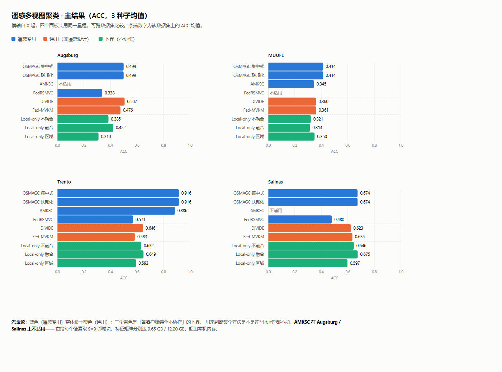

# 遥感多视图聚类统一测试平台 · 实验结果报告

> 生成时间：2026-10-14 11:11:47　|　数据源：`runs.jsonl`（108 条原始记录）

## 结论

**1. 通用算法在遥感数据上掉分。** 最强通用（DIVIDE） vs 最强遥感专用（OSMAGC）：

| 数据集 | DIVIDE | OSMAGC | 差 |
|---|---|---|---|
| Trento | 0.6458 | 0.9158 | -0.2700 |
| MUUFL | 0.3601 | 0.4145 | -0.0544 |
| Salinas | 0.6227 | 0.6736 | -0.0508 |
| Augsburg | 0.5068 | 0.4994 | +0.0075 |

3/4 数据集上遥感专用方法胜。Augsburg 打平（差 0.007 < DIVIDE 自身种子波动 0.0175）。

⚠️ **但遥感专用这一侧并非一致占优——FedRSMVC 是例外，且原因必须交代：**

| 数据集 | FedRSMVC | OSMAGC | DIVIDE |
|---|---|---|---|
| Augsburg | 0.3381 | 0.4994 | 0.5068 |
| Trento | 0.5706 | 0.9158 | 0.6458 |
| Salinas | 0.4796 | 0.6736 | 0.6227 |

FedRSMVC 在三个数据集上都是**已发表方法里最低的**，甚至低于部分下界。
**但这不能直接读成「方法差」**——它的实现是**在超像素级评测的**：
`dataset.py:72` 的 `self.y = get_sp_labels(sp_labels, gt)` 得到的是「每个超像素一个标签」，`Flsimulator` 直接把这个超像素级真值喂给 `full_metric`。
它论文自报的 Augsburg OA=0.7053 就是**超像素级**数字；而本平台按统一协议要求**每像素一个标签**，适配器把超像素标签 broadcast 回像素后重算，才得到 0.3381。

→ **两个口径不是同一个量**（判对 3,836 个均质区域，比判对 161,020 个像素容易得多）。
论文里必须写明这一点，否则读者会拿 0.7053 和别人的像素级数字直接比。

⚠️ **「为什么掉」本平台未做归因实验**，以下三条是待检验假说，**不要当已证结论**：
① 缺少空间邻域建模（遥感地物成片连续，通用方法把像素当独立样本）；② 不处理像素级缺失（MUUFL 有 25%×25% 像素级缺失）；③ 高光谱高维特征不适配（Augsburg 180 / Salinas 204 波段）。

**2. OSMAGC 联邦化零损失。** central 与 federated 的 H 序列**逐元素相同**（10 轮 max|ΔH| = 0）。因其唯一跨视图耦合是求和项 `Σ R_v Z_v`，客户端本地算 `R_v Z_v`、服务器相加即可精确重建——不是近似，是同一个数。代价全在通信量（Trento 182 MB，随像素数 N 线性增长）。⚠️ 前提是视图划分（各客户端共享完整栅格）；区域划分会切断空间平滑，那时才有损失。

**3. 三个方法跑不了，分两类原因：**

| 方法 | 原因 | 类别 |
|---|---|---|
| Fed-MVKM | 视图划分下要求客户端持有全部视图 | 联邦设定不匹配 |
| AMKSC | 内存随「波段数 ×81」增长 | 数据规模 |
| PMIMC | 显存随「N × protorate × batch」增长 | 数据规模 |

→ **「能不能跑」本身是方法设计的一个维度。**

⚠️ **局限**：通用算法仅 2 个样本（Fed-MVKM、DIVIDE），不足以支撑「通用算法普遍不适应遥感」这类表述。

## 一、目标

把通用联邦多视图聚类算法（为图片/文本设计，不了解遥感）与遥感专用算法（OSMAGC / AMKSC，显式建模空间邻域）放到同一批遥感数据上比较，回答：通用算法掉多少分？联邦化损失多大？哪些方法跑不了？

## 二、方法清单

| 方法 | 角色 | 联邦设定 |
|---|---|---|
| `OSMAGC (central, upper bound)` | 遥感专用 · 不联邦 · **上界** | 无需划分（所有视图、所有像素一起跑） |
| `OSMAGC (federated, view)` | 遥感专用 · 联邦化 · baseline | 视图划分（客户端=模态） |
| `AMKSC` | 遥感专用 · 不联邦 · **第二个遥感方法** | 无需划分（逐像素空间块，不联邦） |
| `DIVIDE` | 通用 · 对比学习 · 非遥感设计 | 无需划分（集中式，不联邦） |
| `FedRSMVC` | 遥感专用 · 联邦 · **用户自己的方法** | 视图划分（客户端=模态） |
| `Fed-MVKM (region)` | 通用联邦 · 水平联邦（客户端=样本子集） | 区域划分（客户端=地理区块） |
| `Local-only (view, 不融合)` | 下界 · 各客户端独立评分取平均 | 视图划分（客户端=模态） |
| `Local-only (view, 融合)` | 下界 · 逐视图聚类后对齐融合 | 视图划分（客户端=模态） |
| `Local-only (region)` | 下界 · 各区域独立聚类再拼接 | 区域划分（客户端=地理区块） |

> **注意**：Fed-MVKM 是**水平联邦**（客户端 = 样本子集 + 全部视图），因此只能跑区域划分；在视图划分下它要求«每个客户端持有全部视图»，该前提不成立，属方法设定所限，非实验缺陷。

## 三、数据集

| 数据集 | 尺寸 | 像素数 | 视图 | 类别 | 有标注像素 | 备注 |
|---|---|---|---|---|---|---|
| Augsburg | 332×485 | 161,020 | HS(180)+SAR(4)+DSM(1) | 7 | 78,294 | 唯一被 OSMAGC 与 FedRSMVC 都真跑过的数据集；DSM 为近似重建 |
| MUUFL | 325×220 | 71,500 | HS(64)+LiDAR(2) | 11 | 53,687 | 官方为**缺失率 0.5** 版本：两视图各丢 25%、缺失集不重叠 |
| Trento | 166×600 | 99,600 | HS(63)+LiDAR(2) | 6 | 30,214 | — |
| Salinas | 512×217 | 111,104 | HS(204)+EMP(45)+Gabor(90) | 16 | 54,129 | 仅高光谱一个传感器，另两个视图为派生特征 |

## 四、评测协议

**四条统一**：① 最终接口 = 每像素一个簇标签；② 评价函数一律由 `common/metrics.py` 计算，**不采信任何方法自报的数字**；③ 只评 `gt>0` 的像素；④ 同一份划分、同一组种子。

**指标口径**：ACC（匈牙利置换后）、NMI（算术平均归一化）、ARI、Purity（每簇取最大真值类累加，非置换后的 ACC）。已与 sklearn / OSMAGC / FedRSMVC / Fed-MVKM 四份实现逐位对拍，68 项 0 失配。

**诚实读出协议**：以 k-means 读出的方法统一用 `KMeans(n_init=10, random_state=固定)`，按 inertia 选初始化，**全程不接触真值**。OSMAGC 官方协议是「用真值挑 ACC 最高的那轮」，实测在 MUUFL 上虚高 8.6 个点，本平台禁用。

**协议指纹**：BLAS 线程数 4、COL_CHUNK 25000、读出 n_init=10 —— 换任一项数字都会变，逐条记录在 `runs.jsonl`。

## 五、主结果表



> 四个面板共用同一横轴量程（自 0 起）。蓝=遥感专用、橙=通用、绿=不协作下界。交互版（含悬停数值与深色模式）：`results/figures/accuracy_by_dataset.html`，用 `python scripts/make_chart.py` 重生成。

数值为 **均值±标准差**（多种子）。`—` 表示该组合未运行或不可运行。

### 5.1 ACC

| 方法 | Augsburg | MUUFL | Trento | Salinas |
|---|---|---|---|---|
| `OSMAGC (central, upper bound)` | 0.4994±0.0025 | 0.4145±0.0001 | 0.9158±0.0000 | 0.6736±0.0038 |
| `OSMAGC (federated, view)` | 0.4994±0.0025 | 0.4145±0.0001 | 0.9158±0.0000 | 0.6736±0.0038 |
| `AMKSC` | — | 0.3452±0.0192 | 0.8857±0.0536 | — |
| `DIVIDE` | 0.5068±0.0175 | 0.3601±0.0116 | 0.6458±0.0059 | 0.6227±0.0142 |
| `FedRSMVC` | 0.3381±0.0324 | — | 0.5706±0.0844 | 0.4796±0.0320 |
| `Fed-MVKM (region)` | 0.4756±0.0449 | 0.3615±0.0094 | 0.5834±0.0000 | 0.6346±0.0340 |
| `Local-only (view, 不融合)` | 0.3852±0.0065 | 0.3209±0.0028 | 0.6324±0.0080 | 0.6455±0.0107 |
| `Local-only (view, 融合)` | 0.4216±0.0258 | 0.3144±0.0063 | 0.6493±0.0512 | 0.6745±0.0124 |
| `Local-only (region)` | 0.3100±0.0231 | 0.3495±0.0162 | 0.5926±0.0000 | 0.5971±0.0256 |

### 5.2 NMI

| 方法 | Augsburg | MUUFL | Trento | Salinas |
|---|---|---|---|---|
| `OSMAGC (central, upper bound)` | 0.4236±0.0011 | 0.3737±0.0000 | 0.8584±0.0000 | 0.6965±0.0012 |
| `OSMAGC (federated, view)` | 0.4236±0.0011 | 0.3737±0.0000 | 0.8584±0.0000 | 0.6965±0.0012 |
| `AMKSC` | — | 0.3135±0.0091 | 0.8413±0.0409 | — |
| `DIVIDE` | 0.4982±0.0179 | 0.2283±0.0067 | 0.5410±0.0051 | 0.7699±0.0109 |
| `FedRSMVC` | 0.1657±0.0014 | — | 0.4721±0.0428 | 0.6160±0.0197 |
| `Fed-MVKM (region)` | 0.2058±0.0168 | 0.3541±0.0073 | 0.5257±0.0001 | 0.7477±0.0311 |
| `Local-only (view, 不融合)` | 0.1978±0.0117 | 0.2915±0.0003 | 0.5118±0.0089 | 0.7523±0.0060 |
| `Local-only (view, 融合)` | 0.1757±0.0121 | 0.2210±0.0186 | 0.4881±0.0283 | 0.7758±0.0130 |
| `Local-only (region)` | 0.1744±0.0301 | 0.3418±0.0062 | 0.4544±0.0000 | 0.7085±0.0093 |

### 5.3 ARI

| 方法 | Augsburg | MUUFL | Trento | Salinas |
|---|---|---|---|---|
| `OSMAGC (central, upper bound)` | 0.3097±0.0030 | 0.2616±0.0003 | 0.9147±0.0000 | 0.5161±0.0007 |
| `OSMAGC (federated, view)` | 0.3097±0.0030 | 0.2616±0.0003 | 0.9147±0.0000 | 0.5161±0.0007 |
| `AMKSC` | — | 0.1838±0.0151 | 0.8409±0.0777 | — |
| `DIVIDE` | 0.3744±0.0170 | 0.0694±0.0029 | 0.5480±0.0071 | 0.5153±0.0125 |
| `FedRSMVC` | 0.1028±0.0050 | — | 0.3749±0.0806 | 0.4018±0.0638 |
| `Fed-MVKM (region)` | 0.1436±0.0137 | 0.1733±0.0059 | 0.4710±0.0001 | 0.5444±0.0417 |
| `Local-only (view, 不融合)` | 0.1260±0.0183 | 0.1181±0.0025 | 0.4151±0.0028 | 0.5464±0.0082 |
| `Local-only (view, 融合)` | 0.1146±0.0036 | 0.0842±0.0098 | 0.4086±0.0714 | 0.6024±0.0210 |
| `Local-only (region)` | 0.0956±0.0234 | 0.1666±0.0087 | 0.2967±0.0000 | 0.4627±0.0205 |

### 5.4 Purity

| 方法 | Augsburg | MUUFL | Trento | Salinas |
|---|---|---|---|---|
| `OSMAGC (central, upper bound)` | 0.7012±0.0008 | 0.6364±0.0000 | 0.9158±0.0000 | 0.6756±0.0017 |
| `OSMAGC (federated, view)` | 0.7012±0.0008 | 0.6364±0.0000 | 0.9158±0.0000 | 0.6756±0.0017 |
| `AMKSC` | — | 0.6016±0.0165 | 0.9266±0.0163 | — |
| `DIVIDE` | 0.8503±0.0124 | 0.5345±0.0066 | 0.7168±0.0033 | 0.7103±0.0098 |
| `FedRSMVC` | 0.5633±0.0021 | — | 0.6626±0.0665 | 0.5444±0.0127 |
| `Fed-MVKM (region)` | 0.5435±0.0107 | 0.6128±0.0064 | 0.7054±0.0001 | 0.6541±0.0339 |
| `Local-only (view, 不融合)` | 0.5332±0.0135 | 0.5589±0.0018 | 0.6936±0.0107 | 0.6701±0.0099 |
| `Local-only (view, 融合)` | 0.5565±0.0228 | 0.5401±0.0072 | 0.6921±0.0099 | 0.6829±0.0127 |
| `Local-only (region)` | 0.5159±0.0136 | 0.6096±0.0019 | 0.6357±0.0000 | 0.6469±0.0143 |

## 六、无法运行的组合

| 数据集 | 方法 | 划分 | 原因 |
|---|---|---|---|
| Augsburg | `AMKSC` | none | 像素级空间块内存不可行：161,020 像素 × 14,985 维（=9²×185 波段）× 4B = 9.65 GB > 上限 4.0 GB |
| MUUFL | `FedRSMVC` | view | FedRSMVC 的 config.json 未配置数据集 MUUFL（仅支持 ['Augsburg', 'Salinas', 'Trento']） |
| Salinas | `AMKSC` | none | 像素级空间块内存不可行：111,104 像素 × 27,459 维（=9²×339 波段）× 4B = 12.20 GB > 上限 4.0 GB |

`N/A` 不是实验失败，而是**方法对数据结构/规模的硬依赖**——与 Fed-MVKM 在视图划分下不可运行属同一类结论（视图划分要求客户端持有全部视图）。

## 七、已知问题

1. **Fed-MVKM 在 Augsburg 上不稳定**：三种子 ACC 标准差 ±0.045；`beta_k` 最优值呈孤立尖峰（0.46→0.54→0.41），典型拟合噪声。**不宜作为单一结论依据**。
2. **Fed-MVKM「联邦版优于不联邦版」反常**：Augsburg 上 M=1 ≈0.32、M=4 ≈0.48–0.54，方向与理论相反。适配器已用其官方数据集回归验证（精确复现 ACC=0.8530），故反常来自数据/参数而非代码，**原因待查**。
3. **Salinas 的「多视图」性质特殊**：只有高光谱一个真实传感器，EMP/Gabor 是派生特征，不存在「不同机构持有不同模态」的现实动机。
4. **OSMAGC 超参已逐数据集调优**（`results/tuning_osmagc_*.json`）：四个数据集最优 λ 都是 1，最优 γ 跨两个数量级（1 / 10 / 10 / 100）——λ 可迁移、γ 必须逐数据集调。**论文默认值在四个数据集上全部不是最优**。
5. **未纳入的**：Berlin（本地未接入）；PMIMC（适配器已写但不适用，见第六节）；ASCR / FPFC / MSSAGF / SIMVC-SA（本机无 MATLAB）；CeFMC（本地无代码）。
6. **局限**：通用算法仅 2 个样本，不足以支撑「普遍不适应」这类表述。

## 八、如何复现

```bash
cd D:\cc\算法测试

# 1) 验证指标口径（68 项对拍，应 0 失配）
python scripts/verify_metrics.py

# 2) 验证数据加载与划分
python scripts/verify_data.py

# 3) 验证 OSMAGC 联邦化无损
python scripts/verify_osmagc_federated.py --dataset Augsburg

# 4) 全流程跑批（多数据集 × 多种子）
python scripts/run_full_matrix.py --datasets Augsburg MUUFL Trento Salinas --seeds 0 1 2

# 5) 生成本报告
python scripts/make_report.py
```

环境：Python 3.12 (Anaconda) / numpy 1.26 / scipy 1.13 / sklearn 1.5 / torch 2.5.1+cu124 / RTX 4060 Laptop 8GB

## 附录：原始记录

- `results/runs.jsonl` —— 原始 108 条记录，去重后 108 条（每行一条 JSON，含数据集/方法/划分/种子/四个指标/耗时/协议指纹）
- `results/full_matrix.log` —— 跑批完整日志
- `results/kmeans_readout_*.json` —— k-means 读出协议的逐轮明细
